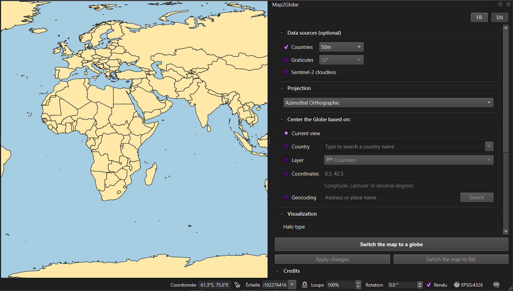
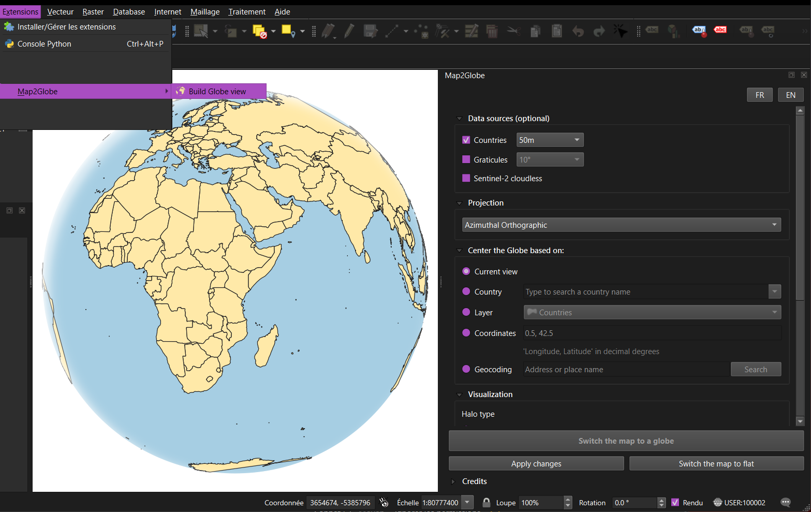
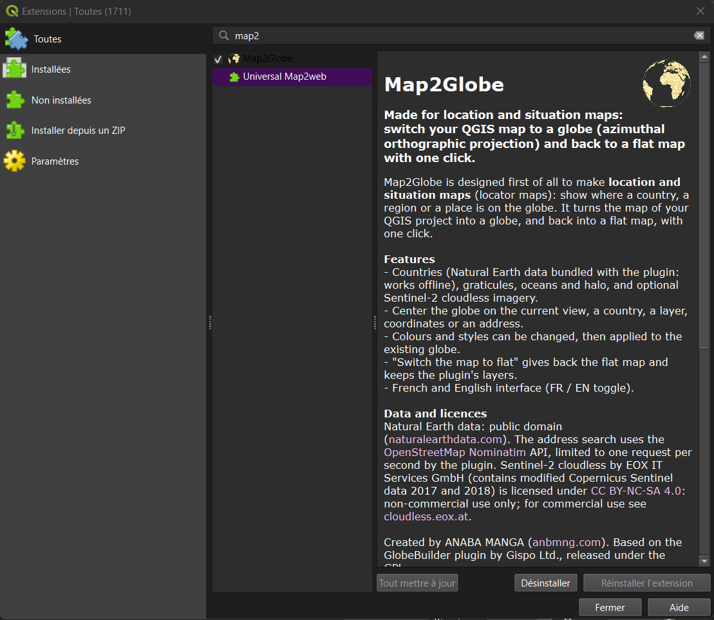

Map2Globe
=========

**Location and situation maps made easy: switch your QGIS map to a globe and back to a flat map with one click.**

     

*A plugin created, designed and maintained by [ANABA MANGA](https://anbmng.com).*

Map2Globe is designed first of all to make **location maps and situation maps** (locator maps): it shows where a
country, a region or a place is on the globe. It builds a globe (azimuthal orthographic projection, "the world from space") from the countries of Natural
Earth and turns the map of your QGIS project into that globe. You can switch back to the flat map at any time, the
layers built by the plugin are kept.

*Map2Globe est conçu avant tout pour réaliser des **cartes de situation et de localisation** : il montre où se trouve
un pays, une région ou un lieu sur le globe. Il transforme la carte de votre projet QGIS en globe, et inversement, en
un clic. L'interface est en français et en anglais (bouton FR / EN).*

## Features

* **Switch the map to a globe / to flat**, keeping the plugin's layers and restoring the previous projection and view.
* Layers: **countries** (Natural Earth, bundled: works offline), **graticules**, **oceans**, **halo** and optional
  **Sentinel-2 cloudless** imagery.
* **Centre the globe** on the current view, a country (searchable list), a layer, coordinates or an address.
* Colours and styles can be changed, then applied to the existing globe with **Apply changes**.
* The globe's projection is named *Map2Globe - Azimuthal Orthographic* instead of "unknown CRS".
* **French and English** interface (FR / EN toggle at the top of the panel; English by default). The generated layers follow the language.

## Screenshots

The panel on a flat map, before the switch:

The globe, and the menu that opens the panel (*Plugins > Map2Globe > Build Globe view*):

Map2Globe in the QGIS plugin manager:

## Requirements

QGIS 4.0 or later (developed and tested on QGIS 4.0.1). The address search and the Sentinel-2 layer need an Internet
connection; everything else works offline.

### Development and test environment

Map2Globe is a pure PyQGIS plugin (no external Python dependency). It was developed and tested on:

| Component | Version |
|---|---|
| QGIS | 4.0.1 |
| Qt | 6.8 |
| Python | 3.12 |
| GDAL / PROJ / GEOS | 3.12 / 9.7 / 3.14 |
| OS | Windows 11 |

How it works: the globe is a custom PROJ azimuthal orthographic projection centred on the origin you choose,
registered as a named user CRS (*Map2Globe - ...*). The halo and the oceans are generated layers saved as files;
the graticules are built with the QGIS Processing algorithms. An automated test suite (pytest and pytest-qgis)
covers the globe, the language switch, the geocoder and the plugin metadata.

## Installation

* **From QGIS**: Plugins > Manage and Install Plugins, search for *Map2Globe* (once published in the official plugin
  repository).
* **From a ZIP**: download `Map2Globe-1.0.0.zip` from the [releases](releases) folder, then Plugins > Manage and Install
  Plugins > Install from ZIP.

## Usage

1. Open the panel with the globe button of the Map2Globe toolbar or the *Plugins > Map2Globe* menu.
2. Choose the data sources, the projection and what to centre the globe on.
3. Click **Switch the map to a globe**.
4. Change the colours or the centre, then click **Apply changes** to update the globe.
5. Click **Switch the map to flat** to go back to a flat map (the plugin's layers are kept).

To use the globe in a print layout, add the map with the layout's own *Add Map* tool: it shows the map drawn in the
workspace.

## Data and licences

* [Natural Earth](https://www.naturalearthdata.com): public domain.
* Address search: [OpenStreetMap Nominatim](https://wiki.openstreetmap.org/wiki/Nominatim) API. The plugin never sends
  more than one request per second, as the usage policy requires.
* Sentinel-2 cloudless by [EOX IT Services GmbH](https://s2maps.eu) (contains modified Copernicus Sentinel data 2017
  and 2018), licensed under [CC BY-NC-SA 4.0](https://creativecommons.org/licenses/by-nc-sa/4.0/): **non-commercial use
  only**; for commercial use see [cloudless.eox.at](https://cloudless.eox.at).

## Credits and licence

**Map2Globe is an original work by [ANABA MANGA](https://anbmng.com)**: concept, design, interface, features and development. Copyright (C) 2026 ANABA MANGA.

It was inspired by the GlobeBuilder plugin by Gispo Ltd., released under the GPL; the copyright notices of that project are kept in the source files, as the licence requires.

Map2Globe is free software released under the GNU General Public License, version 2 or (at your option) any later
version, see [LICENSE](LICENSE).

## Development

See [docs/development.md](docs/development.md).
